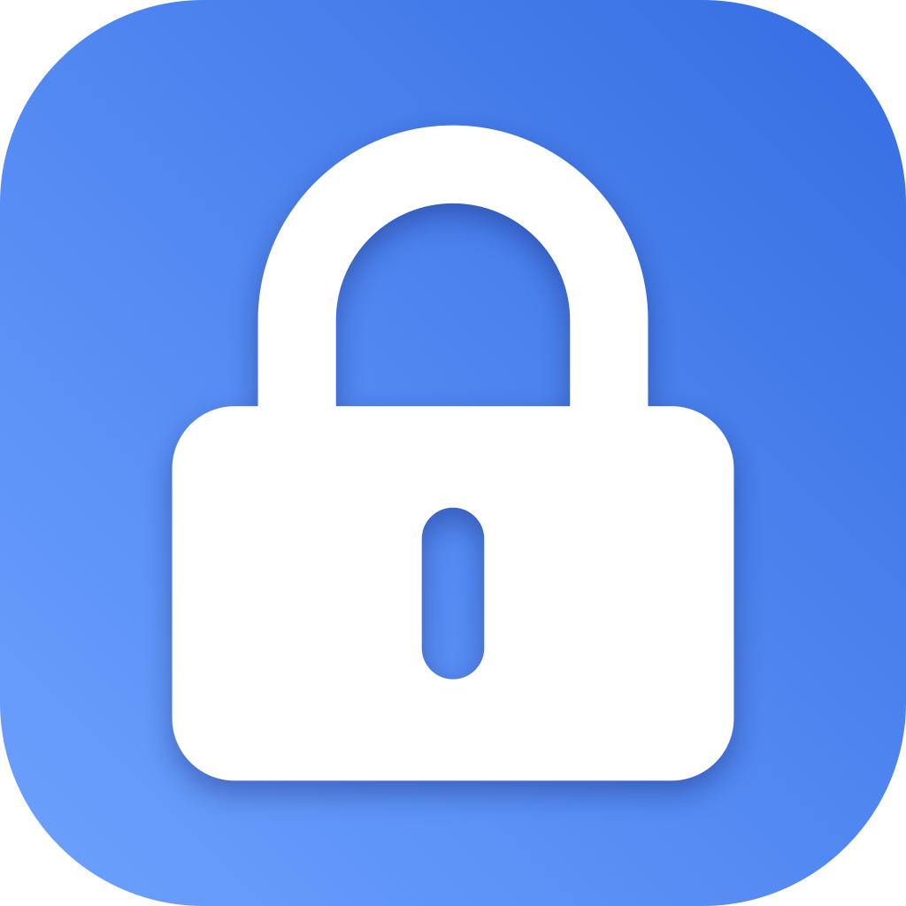

<div align="center">
  
  <h1>Bluetooth Lock · BluetoothLockCN</h1>
  <p>Locks your Mac when you step away.</p>
  <p>A lightweight macOS menu bar app built with SwiftUI and CoreBluetooth.</p>
  <p><a href="README.md">中文</a> · <strong>English</strong></p>
</div>

## Features

- **Bluetooth proximity locking**: Connect to a selected Bluetooth Low Energy (BLE) device and use its RSSI signal to detect when it moves away.
- **Chinese and English**: Switch instantly using “语言 / Language” in the settings section. Your choice is saved locally and applies to the interface, status messages, and future notifications. Chinese is the default; device names stay unchanged.
- **Live signal panel**: View signal strength, the lock threshold, and connection status, with light and dark appearance support.
- **Configurable triggers**: Set a threshold from −100 to −30 dBm and a departure delay of 1, 3, 5, 10, or 15 seconds.
- **Defer locking while in use**: Wait until mouse and keyboard activity stops before locking.
- **Reconnection and notifications**: Attempt to reconnect to the selected device and notify you when it leaves or returns.
- **Menu bar access**: Launch at login or lock your Mac immediately from the panel.

## Requirements

- macOS 13 or later and a Mac with Bluetooth Low Energy support.
- Xcode Command Line Tools. If your installed SDK does not support an API used in the source, use a newer Xcode toolchain.
- A named, connectable BLE peripheral discoverable through CoreBluetooth.

**Not every Bluetooth device is compatible.** Classic Bluetooth audio devices, phones that are not advertising connectable BLE services, and other peripherals may not appear or may fail to connect. The list of paired devices in macOS Bluetooth settings is not the same as this app’s scan results.

## Download and install

Visit [Releases](https://github.com/wang-st/BluetoothLockCN/releases/latest) and download `BluetoothLockCN-v1.0.2-macOS-arm64.zip` (**Apple Silicon, macOS 13+**). Unzip it, drag `蓝牙感应锁.app` into Applications, and open it. This binary does not support Intel Macs; Intel users can try building from source.

The app is not notarized by Apple. macOS may show an unidentified-developer warning on first launch. After verifying the download source, review the opening prompt in **System Settings → Privacy & Security**.

## Build from source

```sh
git clone https://github.com/wang-st/BluetoothLockCN.git
cd BluetoothLockCN
xcode-select --install  # Skip if Command Line Tools are already installed
./build.sh
open "build/蓝牙感应锁.app"
```

The build script uses the system `swiftc`, requires no third-party packages, and does not need an Xcode project. The app is written to `build/蓝牙感应锁.app`.

It builds for the current Mac’s architecture: arm64 on Apple Silicon or x86_64 on Intel. It does not create a Universal Binary. Building and launching have been verified on Apple Silicon; Intel and individual macOS versions still need hands-on testing.

The app is ad-hoc signed locally, without a Developer ID signature or Apple notarization. Building locally from source is recommended; macOS may restrict opening copies distributed to other computers.

## Getting started

1. Open the app and click the lock icon in the menu bar. There is no Dock icon.
2. Allow Bluetooth access and, if you want status alerts, notifications.
3. To use English, scroll to “语言 / Language” in the settings section and select **English**. The interface updates immediately and remembers your choice after restarting.
4. Click **Scan** and select the BLE device you want to monitor.
5. Enable monitoring with the switch at the top right. Adjust the signal threshold and lock delay based on the readings at your desk.
6. Walk away with your device to test locking, then fine-tune the settings for your environment.

RSSI values closer to zero generally mean a stronger signal: −50 dBm is stronger than −80 dBm. A threshold closer to zero generally triggers locking at a shorter distance. RSSI is not an accurate distance measurement; your body, walls, and radio interference affect readings.

With **Defer locking while in use** enabled, input activity within roughly the last five seconds postpones locking. The app also attempts to lock after a device has disconnected or stopped providing signal updates for about ten seconds. This fallback interval is independent of the departure delay in the panel.

For **Launch at login**, move the app to your Applications folder before enabling the setting.

The language setting controls the app’s own text. macOS permission dialogs and system-provided error details are managed by the operating system; the app bundle’s filename remains `蓝牙感应锁.app`.

## Permissions and local data

- **Bluetooth access** is used to scan, connect, and read signal strength.
- **Notifications** are used for status alerts.
- Device names, identifiers, language, and preferences are stored in local `UserDefaults`, not in this source repository.
- The current source contains no telemetry or server upload logic.
- Activity detection only checks the time since the last input event; it does not record keystrokes.

## Current limitations

- Locking dynamically resolves the private `SACLockScreenImmediate` symbol, and lock-state detection depends on an undocumented session dictionary key. These behaviors may change with macOS updates; this implementation is not suitable for direct Mac App Store distribution.
- Bluetooth signal strength provides an additional proximity cue and cannot guarantee timely locking every time you leave. Lock manually when needed.
- Returning with your device does not unlock your Mac. Use the normal macOS unlock flow.
- Targeted lock-state and Bluetooth wake-recovery regression tests are available in `Tests/LockStateTests.swift` and `Tests/BLERecoveryTests.swift`. They do not cover every Bluetooth device or macOS version, and a successful build does not verify actual screen locking.

## Targeted tests

The Bluetooth recovery test calls the production `BLEManager`, with test doubles only for CoreBluetooth devices and connection events. It covers reconnection and continuous RSSI updates after Bluetooth powers off during sleep. Signal refresh after sleep/wake has been manually confirmed on one Mac; other devices and macOS versions still need verification.

```sh
swiftc Sources/BLEManager.swift Sources/Prefs.swift Sources/AppLanguage.swift Tests/BLERecoveryTests.swift -o /tmp/bluetoothlock-ble-tests
/tmp/bluetoothlock-ble-tests
```

## Project structure

```text
Sources/
  main.swift             App entry point
  AppDelegate.swift      Menu bar, panel, and lock state machine
  PanelView.swift        SwiftUI interface
  AppLanguage.swift      Chinese and English text selection
  BLEManager.swift       BLE scanning, connections, and signal polling
  ActivityMonitor.swift  Input activity detection
  LockController.swift   Locking and lock-state detection
  Prefs.swift            Local preferences
  Notifier.swift         System notifications
Assets/                  App and menu bar icons
build.sh                 Compilation, packaging, and local signing
tools/make_icon.swift    SVG icon conversion tool
```

`tools/make_icon.swift` takes an external SVG path and an output directory. The repository already includes the icon assets required to build the app, so you do not need to run this tool for a normal build. The original SVG is not included.

## Contributing

Issues and pull requests are welcome. For connection or locking problems, include your macOS version, Mac architecture, BLE device model, reproduction steps, and expected behavior. Avoid sharing private data such as real device identifiers.

## License

[MIT License](LICENSE) · Copyright (c) 2026 wang-st
