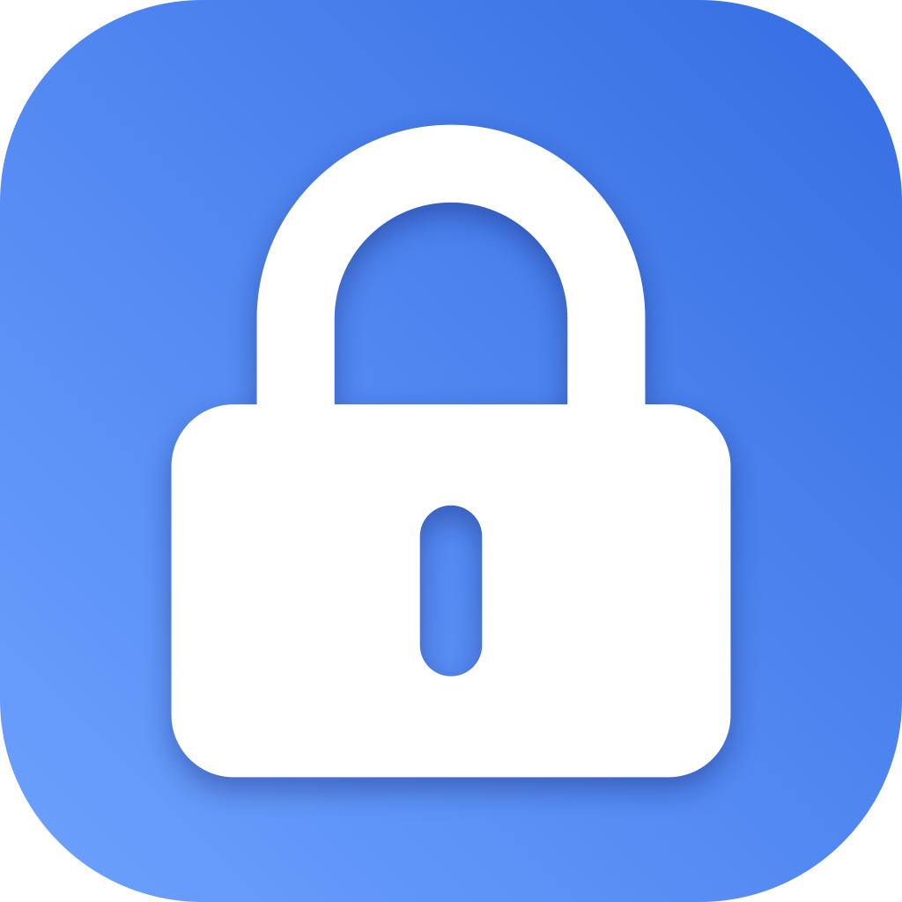

<div align="center">
  
  <h1>蓝牙感应锁 · BluetoothLockCN</h1>
  <p>离开时，自动守护你的 Mac。</p>
  <p>使用 SwiftUI 与 CoreBluetooth 编写的轻量 macOS 菜单栏工具。</p>
  <p><strong>中文</strong> · <a href="README.en.md">English</a></p>
</div>

## 功能

- **蓝牙感应锁屏**：连接指定的低功耗蓝牙（BLE）设备，根据 RSSI 信号变化判断设备是否离开。
- **中英文切换**：在设置区通过「语言 / Language」即时切换中文与 English，选择会保存在本机；界面、状态提示和后续通知使用所选语言。首次使用默认为中文，设备名称保留原样。
- **实时信号面板**：查看信号强度、锁定阈值和连接状态，支持深浅色外观。
- **自定义触发条件**：阈值范围为 −100～−30 dBm，离开延迟可选 1、3、5、10、15 秒。
- **使用中暂缓锁屏**：检测鼠标、键盘等输入活动，等操作结束后再执行锁屏。
- **自动重连与通知**：尝试恢复设备连接，并通过系统通知提示离开、返回等事件。
- **菜单栏常驻**：支持登录时启动，也可以手动立即锁屏。

## 系统要求

- macOS 13 或更高版本，支持低功耗蓝牙的 Mac。
- Xcode Command Line Tools；若所装 SDK 不支持源码中的 API，请使用较新的 Xcode 工具链。
- 一个能被 CoreBluetooth 发现、具有设备名称且允许连接的 BLE 外设。

**不是所有蓝牙设备都适用。** 传统蓝牙音频设备、没有广播可连接 BLE 服务的手机或其他外设，可能不会出现在列表中，或无法建立连接。macOS 蓝牙设置中的已配对设备列表与本应用的扫描结果并不等同。

## 下载安装

前往 [Releases](https://github.com/wang-st/BluetoothLockCN/releases/latest)，下载 `BluetoothLockCN-v1.0.2-macOS-arm64.zip`（**Apple Silicon，macOS 13+**）。解压后将「蓝牙感应锁.app」拖入「应用程序」文件夹，再双击打开。此安装包不适用于 Intel Mac，Intel 用户可尝试从源码构建。

安装包未经过 Apple 公证。首次打开时，macOS 可能提示无法验证开发者；确认下载来源后，可在「系统设置 → 隐私与安全性」中查看并处理系统的打开提示。

## 从源码构建

```sh
git clone https://github.com/wang-st/BluetoothLockCN.git
cd BluetoothLockCN
xcode-select --install  # 已安装命令行工具时跳过
./build.sh
open "build/蓝牙感应锁.app"
```

构建脚本使用系统 `swiftc`，不依赖第三方包，也不需要生成 Xcode 工程。输出位置为 `build/蓝牙感应锁.app`。

脚本按当前 Mac 的架构生成应用（Apple Silicon 为 arm64，Intel 为 x86_64），不会生成 Universal Binary。当前版本已在 Apple Silicon 上完成构建和启动验证；Intel 与各 macOS 版本的行为仍需实际验证。

应用仅做本地 ad-hoc 签名，没有 Developer ID 签名或 Apple 公证。建议从源码本地构建；分发给其他电脑时，macOS 可能限制打开。

## 使用方法

1. 打开应用后，点击菜单栏的锁图标。应用不会显示 Dock 图标。
2. 允许蓝牙访问；如需状态提醒，再允许通知。
3. 需要切换语言时，向下滚动到设置区的「语言 / Language」，选择「中文」或「English」，即时生效并记住选择。
4. 点击「扫描」，选择要监控的 BLE 设备。
5. 打开右上角监控开关，根据当前位置的信号读数调整阈值与离开延迟。
6. 携带设备离开，实际测试一次锁屏触发，再根据使用环境微调。

RSSI 越接近 0，信号通常越强。例如，−50 dBm 比 −80 dBm 强。更接近 0 的阈值通常会在更近的位置触发锁屏；RSSI 不能精确换算为距离，人体遮挡、墙体和无线干扰都会影响读数。

开启「使用电脑时暂缓锁屏」后，最近约 5 秒内有输入活动会暂缓锁屏。设备断连或信号停止更新约 10 秒时，应用也会尝试触发锁屏；这一兜底时间与面板中的离开延迟独立。

需要开机启动时，建议先将应用放入「应用程序」文件夹，再打开「开机自动启动」。

语言设置控制应用自身的文案。macOS 权限弹窗和系统返回的错误详情由系统管理；应用文件名仍为 `蓝牙感应锁.app`。

## 权限与本地数据

- **蓝牙权限**：用于扫描、连接设备与读取信号。
- **通知权限**：用于显示状态提醒。
- 设备名称、标识、语言和偏好设置保存在本机 `UserDefaults` 中，不包含在源码仓库里。
- 当前源码没有遥测或向服务器上传数据的逻辑。
- 活动检测只查询距离上次输入事件的时间，不记录按键内容。

## 当前限制

- 锁屏使用运行时解析的私有符号 `SACLockScreenImmediate`，锁屏状态检测也依赖系统会话字典中的非公开键。这些行为可能随 macOS 更新而变化，当前实现不适合直接用于 Mac App Store 分发。
- 蓝牙信号只能作为辅助在场判断，不能保证每次离开都会及时锁屏；重要场景仍应手动锁屏。
- 设备返回时不会自动解锁，仍需使用 macOS 的正常解锁方式。
- 目前有锁屏状态与蓝牙唤醒恢复的定向回归测试（`Tests/LockStateTests.swift`、`Tests/BLERecoveryTests.swift`）；尚未覆盖所有蓝牙设备和系统版本，构建成功不等同于实际锁屏验证。

## 定向测试

蓝牙恢复测试直接调用生产代码 `BLEManager`，仅用测试替身模拟 CoreBluetooth 的设备与连接事件；覆盖睡眠关闭蓝牙后自动重连并持续刷新 RSSI。已在一台 Mac 上人工确认睡眠唤醒后恢复刷新；其他设备和系统版本仍需验证。

```sh
swiftc Sources/BLEManager.swift Sources/Prefs.swift Sources/AppLanguage.swift Tests/BLERecoveryTests.swift -o /tmp/bluetoothlock-ble-tests
/tmp/bluetoothlock-ble-tests
```

## 项目结构

```text
Sources/
  main.swift             应用入口
  AppDelegate.swift      菜单栏、面板和锁屏状态机
  PanelView.swift        SwiftUI 界面
  AppLanguage.swift      中英文选择与文案切换
  BLEManager.swift       BLE 扫描、连接和信号轮询
  ActivityMonitor.swift  用户活动检测
  LockController.swift   锁屏与锁屏状态检测
  Prefs.swift            本地偏好设置
  Notifier.swift         系统通知
Assets/                  应用图标与菜单栏模板图标
build.sh                 编译、打包与本地签名
tools/make_icon.swift    SVG 图标转换工具
```

`tools/make_icon.swift` 接收外部 SVG 路径和输出目录；仓库已包含构建所需的图标产物，正常构建无需运行此工具。原始 SVG 未随仓库提供。

## 参与贡献

欢迎通过 Issues 报告问题或通过 Pull Requests 改进。反馈连接或锁屏问题时，请附上 macOS 版本、Mac 架构、BLE 设备型号、复现步骤和预期行为，避免提交真实设备标识等私人信息。

## 许可证

[MIT License](LICENSE) · Copyright (c) 2026 wang-st
